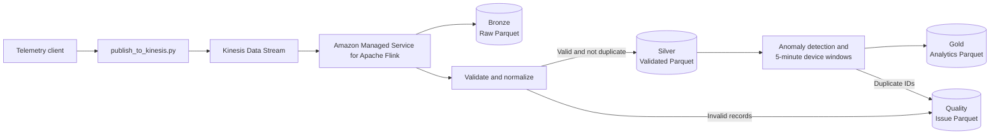
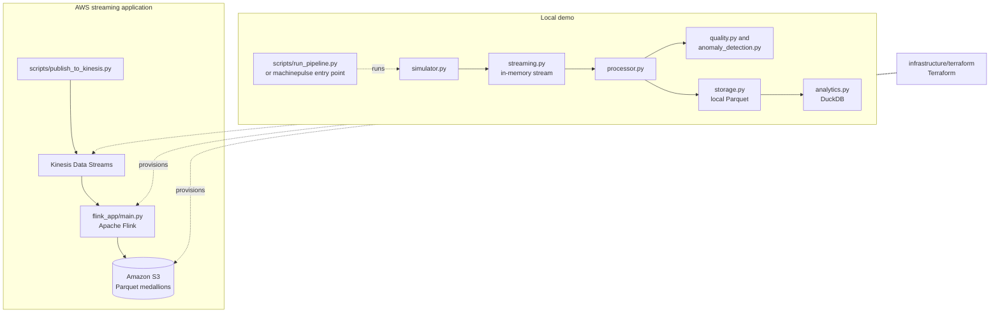

# MachinePulse

[](https://www.python.org/)
[](https://flink.apache.org/)
[](https://aws.amazon.com/kinesis/)
[](https://aws.amazon.com/s3/)
[](https://parquet.apache.org/)
[](https://www.terraform.io/)
[](https://pytest.org/)

**A streaming data lake showcase for industrial IoT telemetry.**

MachinePulse simulates machine readings, publishes them to Amazon Kinesis Data Streams and processes them with a Python Apache Flink application. 
The Flink job writes Bronze, Silver, Gold and Quality datasets as Parquet files to Amazon S3. Terraform provisions the AWS resources; a 
separate local pipeline demonstrates the core processing concepts without requiring AWS.

The project is a streaming data lake with a medallion architecture. Its current
outputs are Parquet files in S3, not Iceberg-managed lakehouse tables.

## Data flow



In the deployed flow, Kinesis is the durable ingestion boundary and Flink processes the stream continuously. Bronze receives every source payload,
including records that later fail validation. Valid records flow into Silver; anomalies and device KPIs flow into Gold; invalid and duplicate 
records are retained in Quality for investigation. The publisher script is a sample telemetry client and can be run more than once to 
send additional records.

## Medallion layers and Parquet outputs

The AWS Flink job writes Parquet in GZIP-compressed format. The default S3 bucket is `machinepulse-data-psardinha`, configurable with the
Terraform `data_bucket_name` variable; Terraform configures these prefixes:

| Layer | S3 location | Contents |
|---|---|---|
| **Bronze — raw data** | `s3://machinepulse-data-psardinha/bronze/` | The original Kinesis payload as a string, retained unchanged in `raw_payload`, plus `ingested_at_utc`. Useful for replay, auditing and reprocessing. |
| **Silver — validated data** | `s3://machinepulse-data-psardinha/silver/` | Validated telemetry in a consistent schema: event ID, device ID, event time, temperature, power and a JSON payload. Repeated event IDs are filtered per device for a five-minute TTL; this is bounded deduplication, not permanent uniqueness enforcement. |
| **Gold — analytical data** | `s3://machinepulse-data-psardinha/gold/` | Curated outputs: detected anomalies under `anomalies/` and per-device KPIs under `device_kpis_5m/`. The five-minute windows are based on processing time and report reading count, average and peak temperature and average and peak power. |
| **Quality — operational data** | `s3://machinepulse-data-psardinha/quality/` | Invalid records and processing issues, including validation failures and duplicate event IDs. Quality is a supporting operational layer, not a standard medallion tier. |

Flink creates the Parquet part files; filenames are generated by the filesystem sink and are not fixed application filenames. The directories 
above are S3 prefixes. The current design does not add a partitioning scheme within those prefixes.

Anomaly alerts use strict thresholds: temperature above 40 °C or power above 70 kW for three consecutive readings. A normal reading 
resets the consecutive count. These rules and the deduplication behavior are implemented in the Flink application; the local demo has 
a separate implementation.

## Project architecture

MachinePulse contains two related but independent implementations:



1. **Local pipeline and demo (`src/machinepulse/`)**
   - `schemas.py` defines the telemetry event model.
   - `simulator.py` creates sample machine telemetry.
   - `streaming.py` provides a lightweight in-memory stream for local runs.
   - `quality.py`, `anomaly_detection.py` and `processor.py` validate and
     process events, maintaining per-device anomaly state.
   - `storage.py` writes local Parquet files; `analytics.py` queries them with
     DuckDB.
   - The root `machinepulse` entry point and `scripts/run_pipeline.py` run this
     demo. It does not use Kinesis or create the S3 medallion outputs.

2. **Deployed streaming application (`flink_app/`)**
   - `main.py` creates the Flink graph: Kinesis source, Bronze branch, validation, per-device keyed processing, five-minute KPI windows and
     Parquet sinks.
   - `processing.py` contains record validation and anomaly rules;
     `flink_processor.py` adapts them to Flink-managed state and applies per-device event-ID deduplication.
   - `kinesis_connector.py` provides the PyFlink Kinesis source bindings used by
     the job. It is based on the
     [Apache Flink AWS connector's PyFlink Kinesis module](https://github.com/apache/flink-connector-aws/blob/9d8347b5bab433e934fbbaf1c37a539ea1731c38/flink-python/pyflink/datastream/connectors/kinesis.py);
     its Apache License 2.0 notice is retained in the source file.
   - `package.sh` builds the Python application ZIP and bundled Java dependencies used by Managed Flink.
   - `test_processing.py` and `test_flink_processor.py` cover Flink-side validation/anomaly behavior and TTL/deduplication behavior.

3. **AWS infrastructure (`infrastructure/terraform/`)**
   - Terraform provisions the Kinesis stream, S3 bucket and security settings, Flink application, execution role and policy and CloudWatch logging.
   - The application is deliberately provisioned stopped. Deploying infrastructure does not start the Flink job.

The local and Flink implementations intentionally have similar validation and anomaly logic, but they are separate code paths: changing one 
does not automatically update or test the other. The tests under `tests/` cover the local pipeline; the two tests under `flink_app/` 
cover Flink-specific logic.

## Requirements

- Python 3.13 or newer
- [uv](https://docs.astral.sh/uv/)
- For AWS publishing/deployment: AWS CLI v2, configured AWS credentials and permissions for Kinesis, S3, Managed Flink, IAM and CloudWatch
- For packaging the Flink application: Java/JDK, Maven, `jar` and `zip`
- For infrastructure: Terraform 1.5 or newer
- See [`pyproject.toml`](pyproject.toml) for full project configuration.


## Install, test and run locally

From the repository root, install project and development dependencies:

```bash
uv sync --dev
```

Run all project tests (local and Flink unit tests):

```bash
uv run pytest
```

To run only the Flink-specific tests:

```bash
uv run pytest flink_app/test_processing.py flink_app/test_flink_processor.py
```

To run only the local-pipeline tests:

```bash
uv run pytest tests/
```

The Flink unit tests use lightweight PyFlink stubs, so they do not require a Flink cluster or AWS credentials. They test application 
behavior, not an end-to-end AWS deployment.

Run the local demo:

```bash
uv run machinepulse
```

Alternatively:

```bash
uv run python scripts/run_pipeline.py
```

The local pipeline generates simulated events, processes them in memory, writes `data/telemetry.parquet` and `data/processing_results.parquet`, 
then prints DuckDB summaries. These local Parquet files are separate from the cloud medallion prefixes.

## Deploy to AWS

Terraform's default region is `eu-west-1`, the Kinesis stream is `machinepulse-telemetry-dev` and the Managed Flink application is
`machinepulse-flink-dev`. The S3 bucket name defaults to `machinepulse-data-psardinha`; S3 bucket names are globally unique, so set
`data_bucket_name` in `terraform.tfvars` if that name is unavailable. Ensure your AWS CLI credentials point to the intended account before applying:

Before running Terraform:

1. Review [`infrastructure/terraform/variables.tf`](infrastructure/terraform/variables.tf) and adjust the variable values as needed.
2. If you want Terraform state stored in S3, uncomment and fill in the backend configuration in
   [`infrastructure/terraform/backend.tf`](infrastructure/terraform/backend.tf) before running `terraform init`.

```bash
aws sts get-caller-identity
```

### Build and provision

Build the application archive first. This requires Java and Maven:

```bash
cd flink_app
./package.sh
cd ../infrastructure/terraform
terraform init
terraform plan
terraform apply
```

Review the plan before applying. Terraform uploads `flink_app/machinepulse-flink.zip` to the S3 artifacts prefix and configures
the application to use it. If you change the Flink Python sources or dependencies, rebuild the archive and apply Terraform again to upload it.

Terraform does **not** start the Flink application. Start it explicitly after the infrastructure is ready:

```bash
aws kinesisanalyticsv2 start-application \
  --application-name machinepulse-flink-dev \
  --region eu-west-1 \
  --run-configuration '{"ApplicationRestoreConfiguration":{"ApplicationRestoreType":"SKIP_RESTORE_FROM_SNAPSHOT"}}'
```

Check its status until it reports `RUNNING`:

```bash
aws kinesisanalyticsv2 describe-application \
  --application-name machinepulse-flink-dev \
  --region eu-west-1 \
  --query 'ApplicationDetail.ApplicationStatus' \
  --output text
```

Once the application is running, publish sample events from the repository
root:

```bash
uv run python scripts/publish_to_kinesis.py \
  --count 100 \
  --device-count 10 \
  --stream-name machinepulse-telemetry-dev \
  --region eu-west-1
```

The AWS publisher uses your configured AWS credentials. The Flink job's logs are sent to the CloudWatch log group
`/aws/kinesis-analytics/machinepulse-flink-dev`. Check application status and logs if objects do not appear in the S3 prefixes; filesystem sinks 
may write files as checkpoints/commits complete rather than immediately for every event.

## Stop and tear down AWS resources

Stop the Flink application before destroying its infrastructure:

```bash
aws kinesisanalyticsv2 stop-application \
  --application-name machinepulse-flink-dev \
  --region eu-west-1
```

Wait until `describe-application` reports `READY`. The S3 bucket has Terraform's `prevent_destroy` guard, so a full teardown requires deliberately
removing that guard from `infrastructure/terraform/s3.tf`. Before doing so, back up anything you need and empty the bucket; deleting the bucket permanently deletes any remaining artifacts and Parquet data. Then review and destroy the Terraform-managed resources:

```bash
cd infrastructure/terraform
terraform plan -destroy
terraform destroy
```

Do not remove the guard or empty the bucket unless you intend to delete its contents. Keep Terraform state files secure and do not commit 
local state or credentials.

## AWS deployment and experimental results

MachinePulse was deployed to AWS to validate the streaming pipeline beyond local unit tests. The experiment published simulated industrial IoT telemetry to Amazon Kinesis Data Streams, processed the records with Amazon Managed Service for Apache Flink and inspected the resulting Parquet objects in Amazon S3.

Experimental procedure:

1. Generate four events for `machine-001`device.
   From project root, run
  ```bash
  uv run python scripts/publish_to_kinesis.py --count 4 --device-count 1
  ```
  This generates four events for machine-001. Their event identifiers are recorded in the deduplication cache when processed.
2. Within the same minute, run the same command again:
  ```bash
  uv run python scripts/publish_to_kinesis.py --count 4 --device-count 1
  ```
  The producer generates the same four event identifiers for the same device. Since these identifiers are already in the deduplication cache, the events are classified as duplicates and excluded from Silver processing. They remain available in Bronze, while the duplicate records are written to the Quality output.
3. Wait at least five minutes from the first publication, then run:
  ```bash
  uv run python scripts/publish_to_kinesis.py --count 200 --device-count 10
  ```
  This generates 200 events across 10 devices. The batch includes the four previously generated event identifiers for `machine-001`.
  Because more than five minutes have elapsed since those identifiers were first inserted into the deduplication cache, their entries should have expired. The four events can therefore be accepted into Silver again, assuming their cache entries have expired before they are processed.

### Results
Produced parquet files can be loaded by pandas as follows:

  ```bash
  uv run python
  >>> import pandas as pd
  >>> df = pd.read_parquet("s3://<AWS-S3-BUCKET-NAME>/bronze", engine="pyarrow")
  >>> print(df)
  ```

  Summary of results is:

  Dataset            | Observed rows | What it demonstrates
  -------------------|---------------|---------------------------------------------------------
  Bronze             | 208           | Raw ingestion, including duplicate publications
  Silver             | 204           | Validated records after duplicate filtering
  Quality            | 4             | Duplicate-event classification
  Gold anomalies     | 4             | Independently evaluated anomaly conditions
  Gold device KPIs   | 11            | Per-device aggregation across two processing-time windows

#### Bronze Medallion
All original records (4 + 4 + 200) are present:
  ```text
                                            raw_payload                   ingested_at_utc
  0    {"event_id":"evt-000001","device_id":"machine-...  2026-10-27T22:26:22.751295+00:00
  1    {"event_id":"evt-000002","device_id":"machine-...  2026-10-27T22:26:22.751423+00:00
  2    {"event_id":"evt-000003","device_id":"machine-...  2026-10-27T22:26:22.751484+00:00
  3    {"event_id":"evt-000004","device_id":"machine-...  2026-10-27T22:26:22.751527+00:00
  4    {"event_id":"evt-000001","device_id":"machine-...  2026-10-27T22:26:30.746192+00:00
  ..                                                 ...                               ...
  203  {"event_id":"evt-000152","device_id":"machine-...  2026-10-27T22:32:14.751091+00:00
  204  {"event_id":"evt-000162","device_id":"machine-...  2026-10-27T22:32:14.751113+00:00
  205  {"event_id":"evt-000172","device_id":"machine-...  2026-10-27T22:32:14.751135+00:00
  206  {"event_id":"evt-000182","device_id":"machine-...  2026-10-27T22:32:14.751157+00:00
  207  {"event_id":"evt-000192","device_id":"machine-...  2026-10-27T22:32:14.751196+00:00

  [208 rows x 2 columns]
```

#### Silver Medallion
All valid records (4 + 0 + 200) are present:
  ```text
        event_id    device_id                   event_time  temperature   power_kw                                       payload_json
  0    evt-000001  machine-001  2026-10-27T22:26:20.921157Z        23.85  48.270964  {"event_id":"evt-000001","device_id":"machine-...
  1    evt-000002  machine-001  2026-10-27T22:26:21.921157Z        24.11  57.019837  {"event_id":"evt-000002","device_id":"machine-...
  2    evt-000003  machine-001  2026-10-27T22:26:22.921157Z        23.98  35.026466  {"event_id":"evt-000003","device_id":"machine-...
  3    evt-000004  machine-001  2026-10-27T22:26:23.921157Z        27.66  47.326625  {"event_id":"evt-000004","device_id":"machine-...
  4    evt-000003  machine-003  2026-10-27T22:32:14.909978Z        23.98  35.026466  {"event_id":"evt-000003","device_id":"machine-...
  ..          ...          ...                          ...          ...        ...                                                ...
  199  evt-000152  machine-002  2026-10-27T22:34:43.909978Z        30.36  38.606175  {"event_id":"evt-000152","device_id":"machine-...
  200  evt-000162  machine-002  2026-10-27T22:34:53.909978Z        31.16  30.837098  {"event_id":"evt-000162","device_id":"machine-...
  201  evt-000172  machine-002  2026-10-27T22:35:03.909978Z        30.18  50.970503  {"event_id":"evt-000172","device_id":"machine-...
  202  evt-000182  machine-002  2026-10-27T22:35:13.909978Z        17.48  42.592632  {"event_id":"evt-000182","device_id":"machine-...
  203  evt-000192  machine-002  2026-10-27T22:35:23.909978Z        22.02  59.543437  {"event_id":"evt-000192","device_id":"machine-...

  [204 rows x 6 columns]
```

#### Quality Medallion
All records rejected as duplicates (0 + 4 + 0) are present:
  ```text
      event_id    device_id  ...             issues_json                                       payload_json
  0  evt-000001  machine-001  ...  ["duplicate_event_id"]  {"event_id":"evt-000001","device_id":"machine-...
  1  evt-000002  machine-001  ...  ["duplicate_event_id"]  {"event_id":"evt-000002","device_id":"machine-...
  2  evt-000003  machine-001  ...  ["duplicate_event_id"]  {"event_id":"evt-000003","device_id":"machine-...
  3  evt-000004  machine-001  ...  ["duplicate_event_id"]  {"event_id":"evt-000004","device_id":"machine-...

  [4 rows x 5 columns]
  ```

#### Gold Medallion, anomalies
These are the records with excess of either temperature or power consumption:
  ```text
      event_id    device_id                   event_time  ...  temperature    power_kw                                       payload_json
  0  evt-000083  machine-003  2026-10-27T22:33:34.909978Z  ...        56.95  107.040358  {"event_id":"evt-000083","device_id":"machine-...
  1  evt-000083  machine-003  2026-10-27T22:33:34.909978Z  ...        56.95  107.040358  {"event_id":"evt-000083","device_id":"machine-...
  2  evt-000117  machine-007  2026-10-27T22:34:08.909978Z  ...        45.08  101.567571  {"event_id":"evt-000117","device_id":"machine-...
  3  evt-000127  machine-007  2026-10-27T22:34:18.909978Z  ...        62.95  114.873979  {"event_id":"evt-000127","device_id":"machine-...

  [4 rows x 7 columns]
  ```
The temperature excess per device is detected at third consecutive reading. The same procedure applies to power consumption.
Temperature and power thresholds are evaluated independently. A single reading that exceeds both thresholds can therefore generate two anomaly records.

#### Gold Medallion, statistics per device per 5 minutes interval
The experiment spanned two five-minute processing-time windows, so there are two windows to consider:
- 1 for the two first steps of the experiment;
- 1 for the third step, unfolded by each of the 10 devices.
The results are shown below:
  ```text
        device_id           window_start_utc             window_end_utc  ...  peak_temperature  average_power_kw  peak_power_kw
  0   machine-001  2026-10-27T22:25:00+00:00  2026-10-27T22:30:00+00:00  ...             27.66         46.910973      57.019837
  1   machine-003  2026-10-27T22:30:00+00:00  2026-10-27T22:35:00+00:00  ...             62.08         64.098822     115.229456
  2   machine-009  2026-10-27T22:30:00+00:00  2026-10-27T22:35:00+00:00  ...             37.27         53.481864      68.141883
  3   machine-007  2026-10-27T22:30:00+00:00  2026-10-27T22:35:00+00:00  ...             62.95         61.202519     114.873979
  4   machine-005  2026-10-27T22:30:00+00:00  2026-10-27T22:35:00+00:00  ...             43.23         49.745854      71.265481
  5   machine-006  2026-10-27T22:30:00+00:00  2026-10-27T22:35:00+00:00  ...             38.73         51.674509      73.214085
  6   machine-004  2026-10-27T22:30:00+00:00  2026-10-27T22:35:00+00:00  ...             43.27         53.617558      70.099009
  7   machine-010  2026-10-27T22:30:00+00:00  2026-10-27T22:35:00+00:00  ...             40.62         54.307368      73.161713
  8   machine-001  2026-10-27T22:30:00+00:00  2026-10-27T22:35:00+00:00  ...             42.93         44.311752      56.434092
  9   machine-008  2026-10-27T22:30:00+00:00  2026-10-27T22:35:00+00:00  ...             51.64         46.922085      58.760122
  10  machine-002  2026-10-27T22:30:00+00:00  2026-10-27T22:35:00+00:00  ...             31.16         49.012782      71.527952

  [11 rows x 8 columns]
  ```

## Next steps: evolve toward a lakehouse

A data lakehouse keeps flexible, lower-cost data lake storage while adding capabilities commonly associated with a data warehouse: managed 
tables, reliable updates, schema evolution, snapshots and SQL analytics.

MachinePulse currently writes open-format Parquet files directly to S3. A lakehouse evolution could add:

1. **AWS Glue Data Catalog** to register schemas and table metadata.
2. **Apache Iceberg Gold tables** to provide snapshots, schema evolution and consistent table operations over the S3 data.
3. **Amazon Athena** to query the cataloged tables with SQL.

  ```mermaid
    flowchart TB
        SIM["Telemetry Simulator<br/>Synthetic machine readings<br/>and event IDs"]
        KDS["Amazon Kinesis Data Streams<br/>Telemetry ingestion"]
        FLINK["Amazon Managed Service for Apache Flink<br/>Deduplication · Anomaly detection<br/>Streaming transformations"]

        SIM --> KDS
        KDS --> FLINK

        subgraph S3["Amazon S3 · Data Lake"]
            direction TB
            BRONZE[("Bronze<br/>Raw telemetry<br/>Parquet")]
            SILVER[("Silver<br/>Cleaned and validated data<br/>Parquet")]
            GOLD[("Gold<br/>Curated analytics data<br/>Parquet")]
            QUALITY[("Quality<br/>Invalid and duplicate events<br/>Parquet")]
        end

        FLINK --> BRONZE
        FLINK --> SILVER
        FLINK --> GOLD
        FLINK --> QUALITY

        subgraph FUTURE["Proposed Lakehouse Evolution"]
            direction TB
            ICEBERG["Apache Iceberg<br/>Managed table format<br/>Snapshots · Schema evolution"]
            GLUE[("AWS Glue Data Catalog<br/>Table metadata")]
            ATHENA["Amazon Athena<br/>SQL analytics and querying"]

            ICEBERG <--> GLUE
            ATHENA <--> GLUE
        end

        CLIENT["Client / Analyst<br/>Ask questions · Submit SQL"]
        CLIENT -. "Questions and SQL queries" .-> ATHENA
        ATHENA -. "Query results" .-> CLIENT

        GOLD -. "Future migration / registration" .-> ICEBERG
        ATHENA -. "Queries Iceberg table data in S3" .-> GOLD

        LEGEND["Solid arrows: implemented today<br/>Dashed arrows: proposed future integration"]

        classDef source fill:#E8F1FF,stroke:#3973AC,color:#17365D,stroke-width:1.5px
        classDef processing fill:#FFF0D9,stroke:#C88719,color:#663C00,stroke-width:1.5px
        classDef lake fill:#E5F5E8,stroke:#438653,color:#194D28,stroke-width:1.5px
        classDef metadata fill:#F0E8FF,stroke:#8064B1,color:#35205E,stroke-width:1.5px
        classDef analytics fill:#DDF5F5,stroke:#31858A,color:#12474A,stroke-width:1.5px
        classDef client fill:#FFF0F5,stroke:#B45C83,color:#6D2344,stroke-width:1.5px
        classDef legend fill:#F5F5F5,stroke:#999999,color:#333333,stroke-dasharray:3 3

        class SIM,KDS source
        class FLINK processing
        class BRONZE,SILVER,GOLD,QUALITY lake
        class ICEBERG,GLUE metadata
        class ATHENA analytics
        class CLIENT client
        class LEGEND legend

  ```

This would be an incremental migration: preserve raw Bronze data, catalog validated Silver data and promote selected Gold outputs to 
Iceberg tables for reliable analytics.
